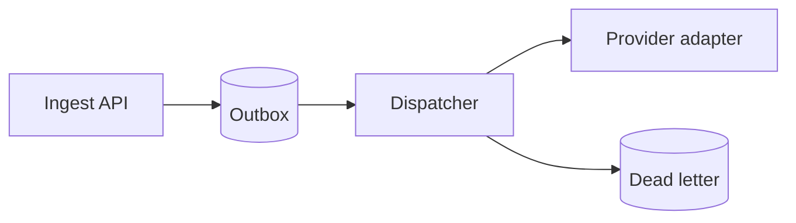

# Visual Guide

Heuristics for choosing and trimming the visual in `visual-first-explanation`.
Read when unsure which form fits, or when a draft feels dense but the cause is
unclear.

## Selection heuristics

- Flow or sequence in time → Mermaid `flowchart` or `sequenceDiagram`.
- State lifecycle → Mermaid `stateDiagram`.
- Entities and ownership → Mermaid `erDiagram`.
- Options differing along the same concerns → table with one concern per column.
- Request shape, event shape, state transition in code → snippet.
- Rule that stays abstract after one reading → concrete scenario with actors,
  trigger, and observable outcome.

When two forms seem to fit, pick the one where the decision-relevant difference
is visible at a glance. Park the other form for a later turn.

## Trimming test

Apply in order before sending:

1. Cover the visual and read the text alone. When the text already carries the
   point, the visual is decorative — remove it.
2. Cover the text and read the visual plus its takeaway alone. When the point is
   clear, the surrounding paragraphs are redundant — remove them.
3. Check whether the same fact appears in two places. Keep the representation
   where the difference is visible, remove the other occurrence.
4. Check whether the visual answers more than the current question. Split the
   turn instead of enlarging the visual.

## Before / after

### Flow explained in prose

Before:

> The webhook platform receives events through the ingest API, stores them in
> the outbox table, and then the dispatcher reads them and forwards them to
> provider adapters. When delivery fails, it retries and eventually moves the
> event to dead-letter storage.

After:



Takeaway: retries stay inside Dispatcher; only exhausted events reach dead letter.

Why better: order and failure boundary are visible without parsing a paragraph.

### Options compared in paragraphs

Before: three paragraphs describing option A, B, C each with cost, latency,
operability mixed in prose.

After:

| Concern | Event-driven | Request-response |
|---|---|---|
| Burst handling | Absorbed by queue | Caller waits |
| Partner outage | Isolated by retry | Propagates to caller |
| Operability | Needs queue ops | Simpler to run |

Why better: shared dimensions line up, so the trade-off is scannable.

### Contract described without shape

Before: prose describing idempotency without showing the key.

After:

```python
# Deduplicate on the provider side before dispatch.
key = f"{merchant_id}:{alert_id}"
```

Takeaway: the same key must travel from ingest to adapter.

Why better: the snippet fixes the exact contract the prose left vague.
